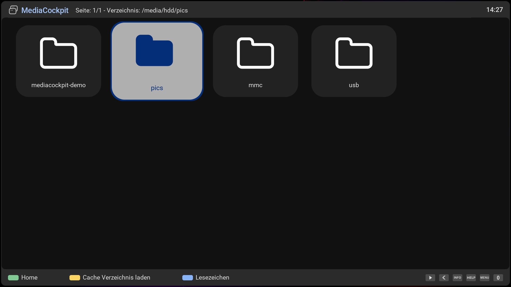
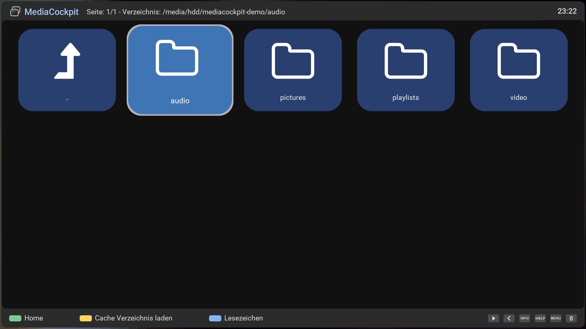
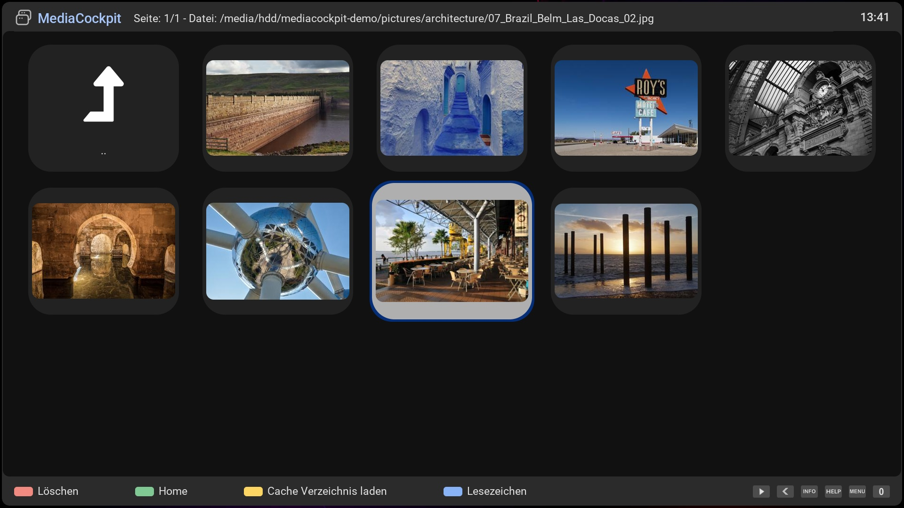
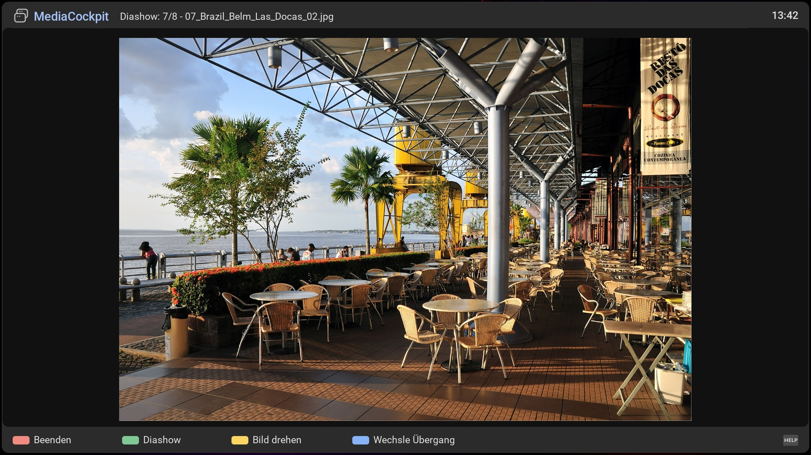
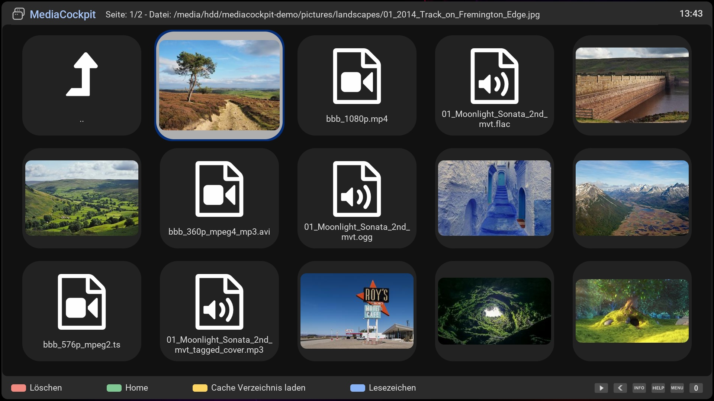
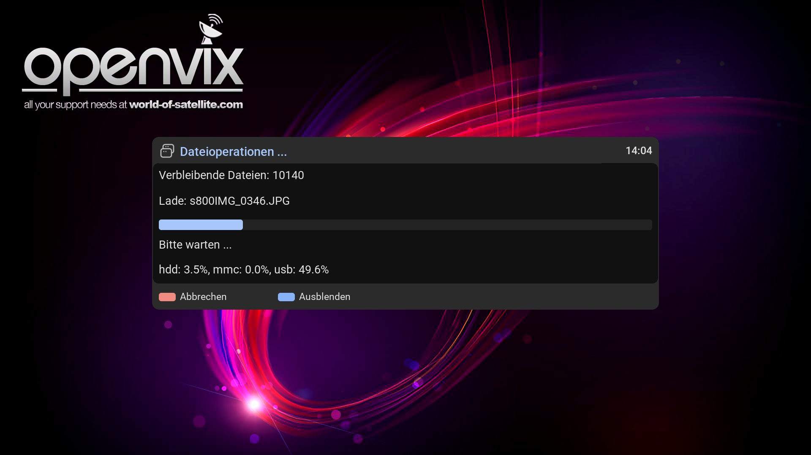

# MediaCockpit (MDC)
MDC is a plugin for browsing media content on Enigma2 receivers. It utilizes an SQL database for quick data access and query functions (CacheCockpit).

## Favorites view

Organize pictures in favorites directories

## Directory view

Show favorite subdirectories

## File view

Show media files

## Picture view

Show picture and picture operations:
- Manual picture rotation
- Automatic picture rotation using Exif data

## Playlist view
[Screenshot](mdc4.jpg)
Show playlists

## Playlist content view

Show playlist content (media files, directories, etc.)
- Mixed media content (pictures and videos) in directories or playlists
- Background music
## Loading progress view

(loading 12000 pictures... 1000 pictures in 90s)

# Slideshows
- Slideshows based on directories, or playlists
- Animation in slideshows

# Music player
- Music player for the songs (.mp3, .wma, etc.) of a directory or playlist: cover, tags, queue, shuffle, repeat (OK on a song, or PLAY in a list without pictures and videos)

## Limitations
- Tested on OpenViX and OpenATV with DM900.

## Installation
- https://OpenCockpit.github.io/MediaCockpit

## Wiki
- https://github.com/OpenCockpit/MediaCockpit/wiki
