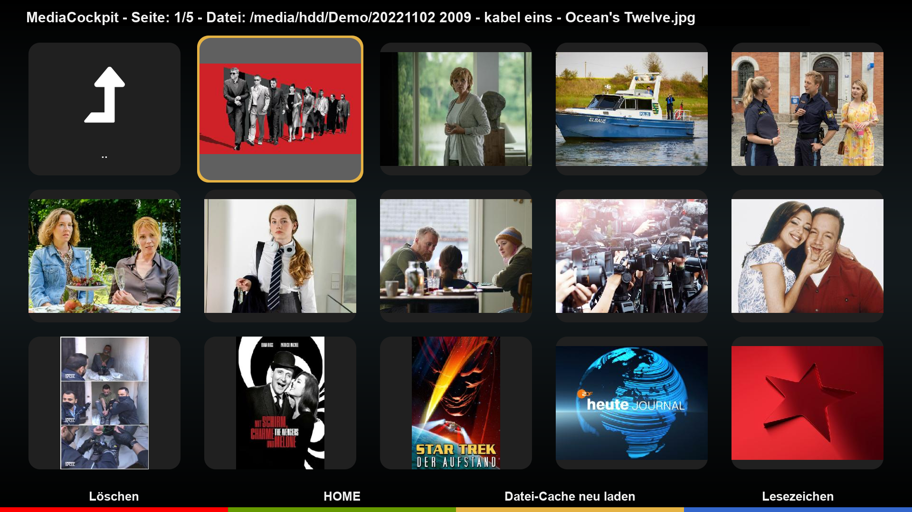

# MediaCockpit (MDC)
MDC is a plugin for browsing media content on Enigma2 receivers. It utilizes an SQL database for quick data access and query functions (CacheCockpit).

# Functions
- Manual picture rotation
- Automatic picture rotation using Exif data
- Slideshows based on directories
- Slideshows based on playlists (.m3u)
- Animation in slideshows
- Mixed media content (pictures and videos) in directories or playlists
- Background music

## Disclaimer
The project author is not responsible for how this software is used by others. It is not intended to be used for accessing or distributing copyrighted materials without authorization.
Users are solely responsible for determining the legality of their actions.

This repository has no control over the streams, links, or the legality of the content provided by the different hosts (including all mirror sites). It is the end user's responsibility to ensure the legal use of these streams, and we strongly recommend verifying that the content complies with all applicable laws, including copyright laws and regulations of your country's jurisdiction before use.

## Limitations
- Tested on OpenViX and OpenATV with DM900.

## Installation
- https://OpenCockpit.github.io/MediaCockpit
