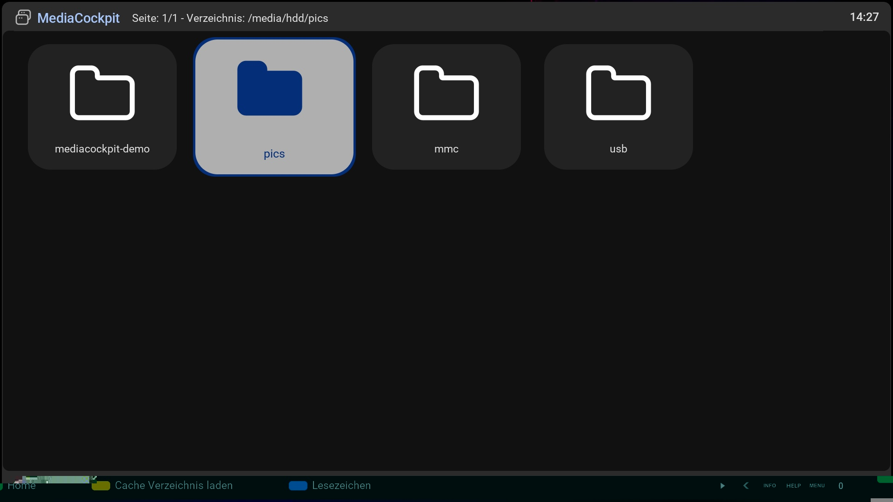
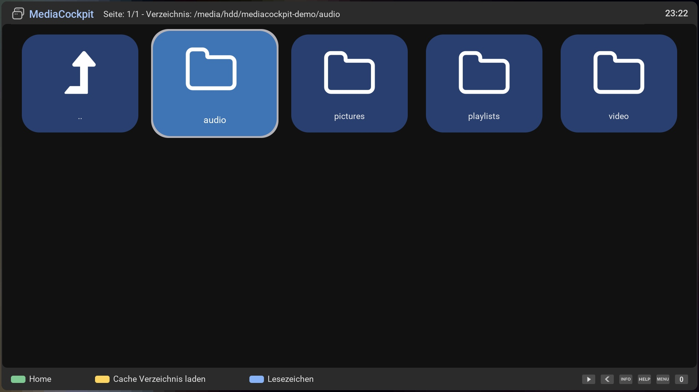
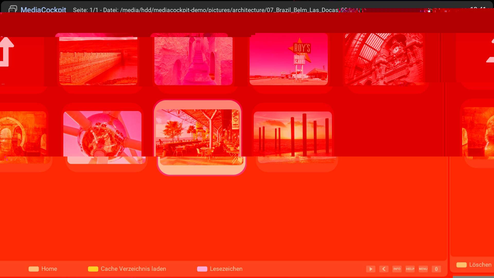
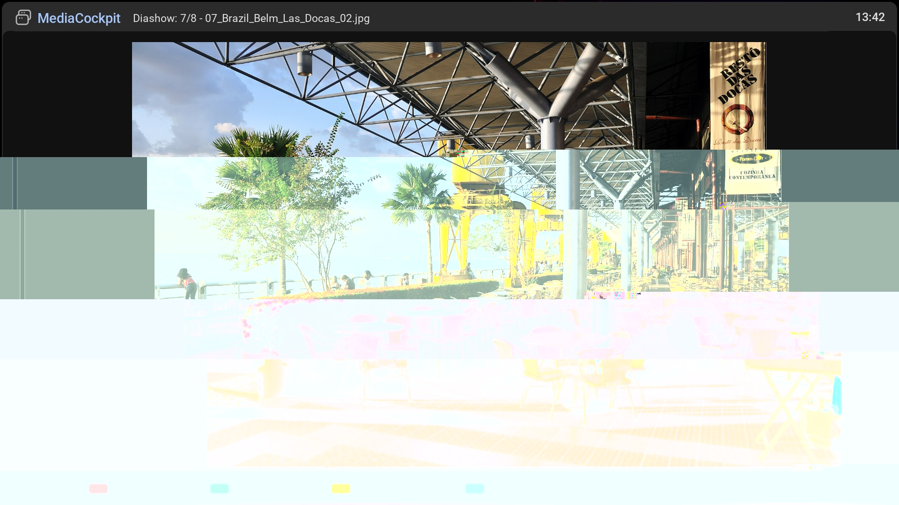
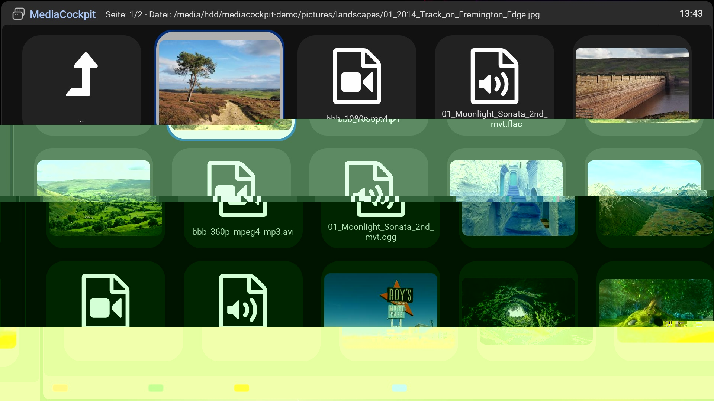
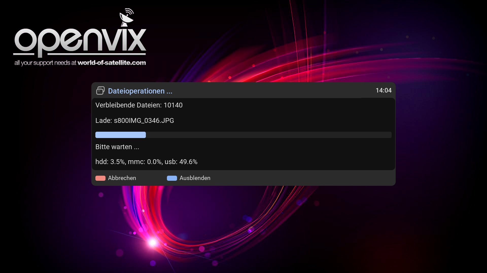

# MediaCockpit (MDC)
MDC is a plugin for browsing media content on Enigma2 receivers. It utilizes an SQL database for quick data access and query functions (CacheCockpit).

## Favorites view

Organize pictures in favorites directories

## Directory view

Show favorite subdirectories

## File view

Show media files

## Picture view

Show picture and picture operations:
- Manual picture rotation
- Automatic picture rotation using Exif data

## Playlist view
[Screenshot](mdc4.jpg)
Show playlists

## Playlist content view

Show playlist content (media files, directories, etc.)
- Mixed media content (pictures and videos) in directories or playlists
- Background music
## Loading progress view

(loading 12000 pictures... 1000 pictures in 90s)

# Manual order
- Put the files of a folder in your own order: **PREVIOUS** / **NEXT** move the selected picture, video or song one place backward / forward
- The order is kept in the folder, in the hidden file `.mediacockpit_order` (one file name per line), and in the cache, so it survives a rebuild of the cache and is read again when a folder is loaded
- **EXIT** and **TEXT** go up one folder, and **EXIT** in the list of favorites leaves MediaCockpit, like **RED** and **POWER**; deleting a file is in the **MENU**

# Slideshows
- Slideshows based on directories, or playlists
- Animation in slideshows

# Picture viewer and editor
- **OK** on a picture opens the picture viewer; **PLAY** runs a slideshow (on a folder: of all pictures and videos in it and in the folders below it), **MENU** switches the transition
- **RED** deletes the picture after a question: it is renamed to `name.jpg.del` (rename it back to get it back) and leaves the lists and the cache
- **GREEN** opens the rotate screen: the bouquet keys turn it by 2 degrees clockwise / counterclockwise, **BLUE** cuts away the empty corners, **GREEN** saves, **RED** cancels
- **YELLOW** turns the picture by 90 degrees (the file keeps its pixels, only the orientation is stored)
- **BLUE** opens the crop screen: the frame starts as big as the picture, the bouquet keys make it smaller / bigger, the arrow keys move it, **OK** or **GREEN** crops
- Rotating by an angle and cropping change the pixels of jpg and png files: the untouched original is kept once as `name.jpg.orig` (hidden from the lists); the camera data (EXIF) stays
- The editor keys work on a single picture and on a paused slideshow

# Music player
- Music player for the songs (.mp3, .wma, etc.) of a directory or playlist: cover, tags, queue, shuffle, repeat (OK on a song, or PLAY in a list without pictures and videos)

## Limitations
- Tested on OpenViX and OpenATV with DM900.

## Installation
- https://OpenCockpit.github.io/MediaCockpit

## Wiki
- https://github.com/OpenCockpit/MediaCockpit/wiki
